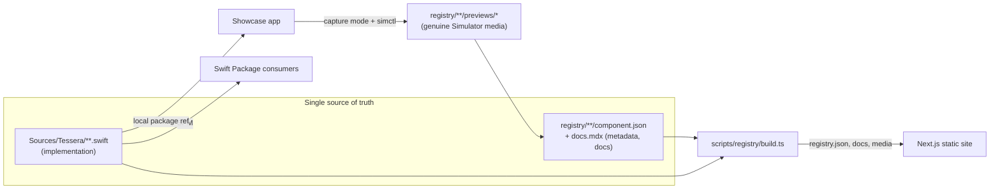
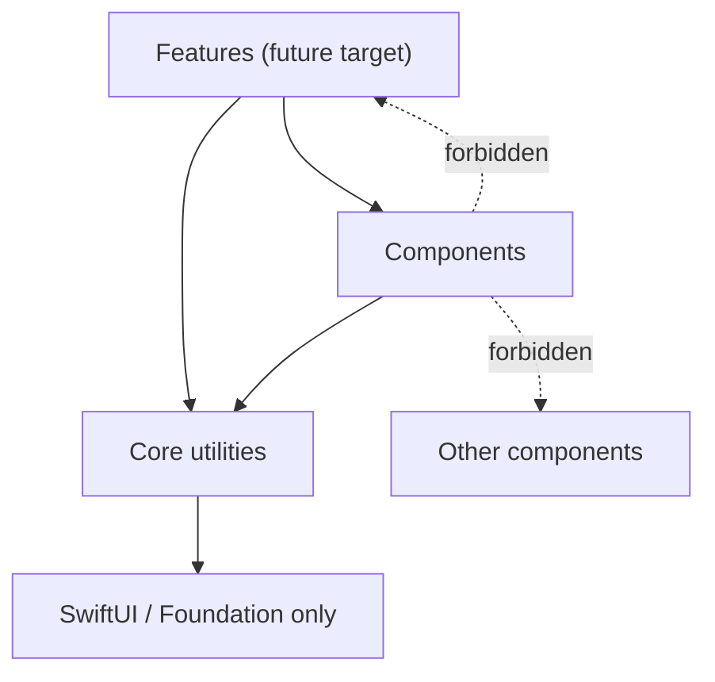
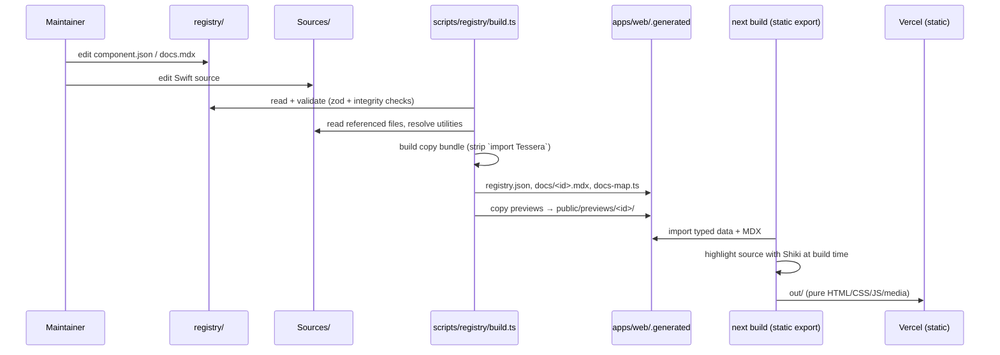
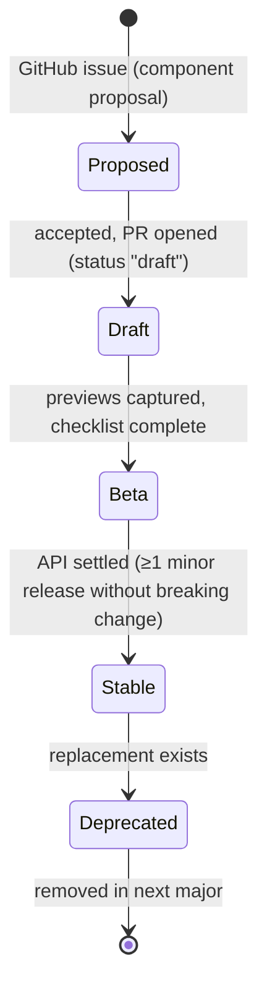

# Tessera — Architecture

> Status: **Phase 1C implemented** (foundation plus the first component, Animated Button). Sections marked *planned* describe later phases.
> Companion documents: [`implementation-plan.md`](./implementation-plan.md), [`technical-decisions.md`](./technical-decisions.md).
> Decision references like **TD-03** point to entries in `technical-decisions.md`.

---

## 1. System overview

Tessera is a free, open-source library of SwiftUI **Components** (single reusable UI elements) and, later, **Features** (complete application flows). It is delivered through four surfaces that all read from **one copy of the Swift source**:

| Surface | Audience | What it is | Source of truth it consumes |
|---|---|---|---|
| **Website** (primary) | Developers browsing | Static Next.js catalog + docs, hosted on Vercel | Registry build output (metadata, source text, preview media, MDX) |
| **Swift Package** | Developers installing | SPM library `Tessera` | `Sources/` directly |
| **Showcase app** | Maintainers, contributors | Native iOS app, run from Xcode; also the preview-capture stage | `Sources/` via local package reference |
| **Registry** | Tooling (website, CI, future CLI/MCP) | Per-item JSON metadata + docs + media | References files in `Sources/`; never copies them |

The core idea: **Swift files in `Sources/` are the only implementation.** Everything else is metadata that *points at* those files, or artifacts *derived* from them (copy-paste bundles, preview media, rendered source on the website).



### Non-goals

- No backend, database, authentication, CLI, or MCP server.
- No running SwiftUI in the browser (§9.4).
- No Features yet — the architecture reserves a place, but no target or page exists until the first Feature.
- No platforms other than iOS. The layout allows adding them later (§11).
- No App Store or binary distribution of the Showcase; it runs from source in Xcode.

---

## 2. Repository structure

A single Git repository. The **Swift package lives at the repository root** because SPM requires `Package.swift` at the root of the repository URL consumers add (**TD-01**).

```
tessera/
├── Package.swift                     # SPM manifest (root; Swift 6, iOS 17)
├── Sources/Tessera/                  # The one library target (TD-02)
│   ├── Tessera.swift                 # Module notes; keeps the empty target buildable
│   ├── Core/                         # Shared utilities, file-granular, opt-in (empty)
│   └── Components/                   # One folder per component (empty)
├── Tests/TesseraTests/               # Swift Testing
│
├── registry/                         # Metadata + docs + media (no Swift code)
│   ├── categories.json               # Allowed component categories
│   ├── schema/                       # JSON Schemas generated from scripts/registry/schema.ts
│   ├── components/<id>/              # component.json, docs.mdx, previews/
│   └── utilities/<id>/               # utility.json
│
├── apps/
│   ├── showcase/
│   │   ├── TesseraShowcase.xcodeproj # Synchronized folders, local package ref, shared scheme
│   │   ├── TesseraShowcase/
│   │   │   ├── App/                  # Entry point, launch configuration
│   │   │   ├── Catalog/              # CatalogEntry, CaptureScenario, Catalog, CatalogView
│   │   │   ├── Detail/               # ComponentDetailView (playground + environment controls)
│   │   │   ├── Capture/              # CaptureStage, CaptureRootView, StageBackground
│   │   │   └── Demos/<Name>/         # Per-component demos (planned, from Phase 1C)
│   │   └── TesseraShowcaseUITests/   # Launch-mode smoke tests + accessibility audit
│   └── web/                          # Next.js App Router site
│       ├── app/                      # Routes
│       ├── components/               # React UI
│       ├── content/docs/             # Site docs (MDX) + nav index
│       ├── lib/                      # Registry loader, highlighter
│       ├── .generated/               # gitignored: registry build output
│       ├── public/previews/          # gitignored: copied preview media
│       └── vercel.json
│
├── scripts/registry/                 # Node (native TypeScript) tooling
│   ├── schema.ts                     # zod schema (single definition)
│   ├── load.ts                       # Load + validate + bundle helpers
│   ├── check.ts / build.ts / hash.ts / generate-schema.ts
│   ├── output.ts                     # Types of the build output (shared with the website)
│   ├── registry.test.ts              # node:test suite
│   └── fixtures/basic/               # Fake registry for tests and website fixture builds
│
├── docs/                             # Architecture, plan, decisions, guidelines, capture guide
├── .github/                          # CI workflows, Dependabot, issue/PR templates
├── AGENTS.md / CLAUDE.md             # Agent conventions and commands
├── CONTRIBUTING.md / CHANGELOG.md / LICENSE / README.md
├── Makefile                          # Cross-language task entry point
├── package.json                      # npm workspace root (scripts + tooling deps)
├── tsconfig.json                     # Typecheck config for scripts/
└── .xcode-version / .nvmrc / .swift-format / .editorconfig
```

### Naming conventions

| Thing | Convention | Example |
|---|---|---|
| Registry id | kebab-case, globally unique | `animated-button` |
| Swift folder | UpperCamelCase of the id | `Components/AnimatedButton/` |
| Primary Swift type | UpperCamelCase of the id | `AnimatedButton` |
| Preview scenario id | kebab-case, matches a Showcase `CaptureScenario` | `default`, `async-success` |
| Preview media file | `previews/<scenario>-<scheme>[-poster].<ext>` | `previews/default-dark.mp4` |
| Utility id | kebab-case | `haptics` |

These rules let tools and AI agents derive every path from an id without lookup tables.

---

## 3. Module boundaries

### 3.1 Swift targets

| Target | Contains | May depend on | Product |
|---|---|---|---|
| `Tessera` | `Core/`, `Components/` | SwiftUI, Foundation | `Tessera` (library) |
| `TesseraTests` | Unit tests | `Tessera`, Swift Testing | — |
| `TesseraFeatures` *(planned, not created)* | `Features/` | `Tessera` | `TesseraFeatures` |

Consumers write `import Tessera`. `defaultLocalization: "en"` is set so resources can be added without a manifest change.

### 3.2 Dependency rules



1. **Components never depend on Features.** Enforced by module boundary once `TesseraFeatures` exists.
2. **Components never depend on other components.** Shared code becomes a Core utility. Keeps copy-paste bundles flat.
3. **Components may use Core utilities only if declared** in `component.json` → `dependencies.utilities`. The registry resolves and validates declarations today; the standalone copy-paste compile check that enforces them is planned for Phase 1C (§7.3).
4. **Core utilities are file-granular** and may depend on other utilities only if declared. Cycles are rejected.
5. **No third-party runtime dependencies** (**TD-11**).

### 3.3 Components vs Features

| | Component | Feature (planned) |
|---|---|---|
| Scope | One reusable UI element | A complete user-facing flow (onboarding, settings, paywall) |
| State | Local view state only; caller owns data | May own view models and navigation |
| Side effects | None beyond haptics/animation | May define protocols the host app implements |
| Strings | Caller-provided; English defaults only where unavoidable | Owns its strings |
| Location | `Sources/Tessera/Components/<Name>/` | `Sources/TesseraFeatures/<Name>/` |
| Registry | `registry/components/<id>/component.json` | `registry/features/<id>/feature.json` |
| Website | `/components/<id>` | `/features/<id>` |

---

## 4. Data flow

### 4.1 Build-time data flow (website)



`npm run build -w web` runs the registry build, then `next build`. Nothing runs at request time.

### 4.2 Preview data flow

**Current (scripted, Phase 1C)** — see [`preview-capture.md`](./preview-capture.md):

1. `scripts/previews/capture.sh <id> <scenario> <light|dark>` builds the Showcase for testing on the pinned simulator (iPhone 17 Pro, iOS 26.2).
2. It starts `xcrun simctl io recordVideo` and runs `PreviewCaptureTests`, which launches capture mode (`-tessera-capture <id> -tessera-scenario <s> -tessera-scheme <scheme>`) and performs the scenario's real touches.
3. The script locates the first touch from the recording itself (end of the resting stretch), converts to 30 fps, trims, crops to 900 × 900 and encodes MP4 + PNG poster into `registry/components/<id>/previews/`.
4. The maintainer adds the scenario and capture metadata (device, OS, Xcode, date, `sourceHash`) to `component.json`.

A manual fallback with the same capture mode remains documented. Writing metadata automatically is not implemented.

---

## 5. Component lifecycle



- Authored `status`: `draft | beta | stable | deprecated`. `draft` may ship without previews; every other status requires light and dark previews (validated).
- Computed `released`: true when `since` ≤ the latest SemVer Git tag. The website shows an **Unreleased** badge otherwise.
- Definition of done: [`component-guidelines.md`](./component-guidelines.md) checklist.

---

## 6. Registry architecture

### 6.1 Purpose

The registry is the machine-readable index of what Tessera contains: metadata, documentation and media — **never a second copy of Swift code**.

### 6.2 `component.json`

```jsonc
{
  "$schema": "../../schema/component.schema.json",
  "id": "animated-button",               // must equal the folder name
  "kind": "component",
  "name": "Animated Button",
  "summary": "…",                         // ≤ 160 chars
  "category": "buttons",                  // must exist in registry/categories.json
  "tags": ["button", "animation"],
  "status": "draft",                      // draft | beta | stable | deprecated
  "since": "0.1.0",                       // optional until released
  "platforms": { "iOS": "17.0" },
  "source": { "files": ["Sources/Tessera/Components/AnimatedButton/AnimatedButton.swift"] },
  "dependencies": { "utilities": [], "frameworks": ["SwiftUI"] },
  "docs": "docs.mdx",
  "previews": [
    {
      "id": "default",
      "title": "Press feedback",
      "media": [
        { "kind": "video", "scheme": "light", "file": "previews/default-light.mp4",
          "poster": "previews/default-light-poster.png", "width": 900, "height": 900 }
      ],
      "capture": { "method": "manual", "device": "iPhone 17 Pro", "os": "iOS 26.2",
                   "xcode": "26.2", "capturedAt": "2026-10-22", "sourceHash": "<sha256>" }
    }
  ],
  "accessibility": { "voiceOver": true, "dynamicType": true, "reduceMotion": true, "notes": "…" }
}
```

Preview metadata lives inline with the component rather than in a separate manifest: one file to edit during manual capture.

### 6.3 `utility.json`

```jsonc
{ "id": "haptics", "kind": "utility", "summary": "…",
  "source": { "files": ["Sources/Tessera/Core/Haptics/TesseraHaptics.swift"] },
  "dependencies": { "utilities": [] } }
```

Utilities are not listed in the catalog; they appear on component pages as shared helper files.

### 6.4 Validation (`npm run registry:check`)

Errors (fail CI):

- Invalid JSON or schema violations (with field paths).
- `id` ≠ folder name; unknown category; duplicate categories.
- `source.files` missing, not under `Sources/`, not `.swift`, or owned by two items.
- Unknown or cyclic utility dependencies.
- Missing `docs.mdx`.
- No Showcase entry (`id: "<id>"` in `apps/showcase/TesseraShowcase`).
- Non-draft status without light and dark previews; missing media files; duplicate scenario ids.
- Media over budget (images 400 KB, videos 1.5 MB).

Warnings: preview `sourceHash` differs from the current source (possibly stale preview).

The schema is defined once in zod (`scripts/registry/schema.ts`); `registry/schema/*.json` is generated from it (**TD-04**). Rules are covered by `scripts/registry/registry.test.ts` against `fixtures/basic`.

### 6.5 Build output

`scripts/registry/build.ts` writes to `apps/web/.generated/` (gitignored), typed by `scripts/registry/output.ts`:

- `registry.json` — version, latest release, repository URL, categories with counts, and per component: metadata, `released`, copy-paste `files` (component files first, then utilities, each with role and owner), `singleFile` (all files combined), and previews with public URLs.
- `docs/<id>.mdx` and `docs-map.ts` (static imports, so an empty registry is valid).
- Media copied to `apps/web/public/previews/<id>/`.

Copying inputs into the web app avoids bundler configuration for files outside the Next.js root (**TD-07**).

---

## 7. Distribution architecture

### 7.1 Swift Package Manager

```swift
.package(url: "https://github.com/ogulcanhq/tessera", branch: "main")   // until the first tag
.product(name: "Tessera", package: "tessera")
```

Root `Package.swift`, `swift-tools-version: 6.0`, `swiftLanguageModes: [.v6]`, `platforms: [.iOS(.v17)]`. Versioned by Git tags (**TD-12**).

### 7.2 Copy-paste

Each component page offers one tab per file (component files, then shared helpers) with copy buttons, an **All files in one** tab, and an install panel listing the files and their roles.

**The only transformation** between repository source and copy-paste source is removal of lines matching `^import Tessera(Features)?$`. Everything else, including the license header, is byte-for-byte identical (tested).

### 7.3 Internal dependencies and shared utilities

1. **Declared, not discovered.** Components declare utilities; the resolver appends the transitive closure, dependencies first, deduplicated.
2. **Flat bundles.** Components can't depend on components.
3. **Namespaced utilities** (`Tessera` prefix) and stable file names, so a helper pasted for two components is recognizable; the website labels them "Shared helper, add once".
4. **Package-vs-app differences** (if ever needed) are isolated in a utility using `#if SWIFT_PACKAGE`. No component needs this yet; the first component uses caller-provided text instead of package resources (**TD-16**).
5. **Copy-safe access control.** `public` API is valid in an app target. Top-level `private` names must be unique across a bundle so the combined file compiles.
6. **Standalone compile check** *(planned, Phase 1C)*: typecheck every bundle — as separate files and as the combined file — with `swiftc -typecheck` against the iOS Simulator SDK, Swift 6, iOS 17, without `SWIFT_PACKAGE`. Deferred from 1B because there is no component to check.

---

## 8. Showcase architecture

### 8.1 Role

A browsable native demo of every component, a playground for manual QA, and **the stage that produces website preview media**. Runs locally from Xcode; not distributed as a binary.

### 8.2 Structure

| File | Responsibility |
|---|---|
| `App/TesseraShowcaseApp.swift` | Chooses catalog or capture mode; applies appearance |
| `App/LaunchConfiguration.swift` | Reads `-tessera-capture/-scenario/-scheme` from the `UserDefaults` argument domain; `Appearance` preference |
| `Catalog/CatalogEntry.swift` | `CatalogEntry` (id, name, summary, category, scenarios, playground) and `CaptureScenario` (id, title, content) |
| `Catalog/Catalog.swift` | `@MainActor enum Catalog { static let entries }` keyed by registry id |
| `Catalog/CatalogView.swift` | Grouped list, appearance menu, accessible empty state |
| `Detail/ComponentDetailView.swift` | Playground on a stage with environment overrides (light/dark, Dynamic Type XS–AX5, RTL) and links to each capture scenario |
| `Capture/CaptureStage.swift` | Chrome-free stage (status bar and home indicator hidden), `CaptureRootView`, `StageBackground` (matches the website's `--stage`) |

- Local package reference to `../..` — always builds current source.
- Xcode synchronized folders: adding files doesn't edit `project.pbxproj` (**TD-09**).
- Shared scheme includes disabled capture launch arguments for quick toggling.
- `AnyView` is used only in demo plumbing, never in the package.

### 8.3 Tests

`TesseraShowcaseUITests/ShowcaseLaunchTests`:

- `testCatalogLaunches` — catalog appears; `performAccessibilityAudit()` passes.
- `testCaptureModeHidesAppChrome` — capture mode renders the stage with no navigation bar.

Per-component capture and audit tests are added with each component. Snapshot libraries, if adopted, go here — never in `Package.swift` (**TD-10**).

---

## 9. Website architecture

### 9.1 Stack

Next.js 16 (App Router, Turbopack) · React 19 · TypeScript · Tailwind CSS 4 · `@next/mdx` + `remark-gfm` · Shiki · static export (`output: "export"`). Fonts: Instrument Sans (text and display), JetBrains Mono (code only), self-hosted via `next/font`.

### 9.2 Routes

| Route | Content |
|---|---|
| `/` | Compact hero with key facts, featured components (or the in-progress component while the registry is empty), category index, install snippet and docs entry points. A Features section is added only once features exist |
| `/components` | Search, category filter (`?category=`, `?q=`) and gallery grid. While the registry is empty: a description of the component in progress plus the category index, no placeholder cards |
| `/components/[id]` | Name, summary and status; full-width preview stage with scenario and light/dark controls; installation; source viewer; usage docs (MDX); accessibility; sticky "On this page" and details |
| `/docs`, `/docs/[slug]` | Introduction, Installation, Accessibility, Contributing, with previous/next links |

A ⌘K / Ctrl-K palette in the header searches components, populated categories and docs.

`/components/[id]` uses `generateStaticParams` with `dynamicParams = false`. Static export rejects an empty params list, so while the registry is empty a single placeholder param renders the 404 page.

### 9.3 Building blocks

| Component | Notes |
|---|---|
| `PreviewPlayer` (client) | Full-width stage that takes the recording's appearance; scenario and light/dark segmented controls; follows the site theme by default; autoplay muted loop, or poster + "Play recording" under `prefers-reduced-motion`; honest empty state when no preview exists; caption names device and iOS version |
| `ComponentCard` (client) | 4:3 gallery card; video plays only while visible and motion is allowed |
| `CatalogBrowser` (client) | Search (`/` to focus, Esc to clear), category filter, result count announced as a status; filter mirrored to the URL |
| `SiteSearch` (client) | Command palette on native `<dialog>`, WAI-ARIA combobox/listbox |
| `CatalogEmpty`, `CategoryIndex` (server) | Empty-registry state (text only, from `lib/upcoming.ts`) and category rows that link only when populated |
| `CodeBlock` (server) | Shiki dual-theme HTML at build time + `CopyButton` island |
| `CopyButton` (client) | Clipboard API with a screen-reader status message and failure state |
| `Tabs` (client) | WAI-ARIA tabs with arrow/Home/End keys; panels can be server-rendered |
| `InstallSection`, `SourceSection` (server) | Install methods and per-file source |
| `ThemeToggle` (client) | System/light/dark; inline head script prevents a flash |

### 9.4 Genuine SwiftUI previews without SwiftUI in the browser

SwiftUI only runs on Apple platforms, and re-implementing components in HTML/CSS would be a second, divergent implementation. The website shows **recordings of the real component**: the Showcase renders it from `Sources/` in the iOS Simulator, the recording is encoded to MP4/PNG, and the registry records device, OS, Xcode version, date and a source hash. The browser plays ordinary media; what visitors copy is the exact code that produced it.

### 9.5 Visual design

"Stage and specimen": a neutral graphite palette with one jade accent used for interaction and state (links, focus, status), never decoration. The recurring element is the **stage**, the surface previews are recorded on; `--stage` in `globals.css` matches `StageBackground` in the Showcase (`#EEF0F3` light, `#1A1C21` dark), so a square recording blends into a wide stage. Tokens in `apps/web/app/globals.css`:

- **Type:** Instrument Sans, scale 13 / 14 / 15 / 17 / 20 / 26 / 34 / 48 px (`text-meta` … `text-display`); headings semibold with tight tracking (`.heading`). Mono only for code.
- **Radii by role:** controls 7 px, cards 12 px, stages 18 px. No pill buttons.
- **Depth:** 1 px borders; the only shadow is on the command palette.
- **Layout:** 1200 px container; 16 / 24 / 32 px gutters at mobile / `sm` / `lg`; gallery 1 / 2 / 3 columns.
- **Motion:** 140 ms color transitions on interaction and a 160 ms palette entrance; all disabled under reduced motion, where videos show a poster until played.

Original design; no third-party branding, layouts or assets.

### 9.6 Hosting

Vercel, project root `apps/web`, build command `npm run build` (`apps/web/vercel.json`), files outside the root directory included (the build reads `registry/`, `scripts/`, `Sources/`). Not yet connected (Phase 1D).

---

## 10. Accessibility & localization

Every component must support VoiceOver (labels, traits, values, announcements), Dynamic Type through AX5, Reduce Motion alternatives, 44×44 pt targets, light/dark, RTL, and sufficient contrast. Text is caller-provided (`LocalizedStringKey`, `Text`, `@ViewBuilder`); built-in strings are avoided, and where unavoidable use English defaults with a caller override. Verification: Showcase environment controls plus `performAccessibilityAudit()` in CI. Details in [`component-guidelines.md`](./component-guidelines.md).

The website uses semantic landmarks, a skip link, visible focus, accessible tabs and copy feedback, and respects `prefers-reduced-motion`.

---

## 11. Extensibility without overengineering

| Future need | Where it goes | What changes |
|---|---|---|
| Features | `Sources/TesseraFeatures/`, `registry/features/`, `/features` | Add target + product; registry `kind: "feature"` |
| More components | Folders following naming conventions | Nothing structural |
| Package resources / localization | `Sources/Tessera/Resources/` + a `localization` utility using `#if SWIFT_PACKAGE` | Add `resources:` to the target |
| Automated preview capture | `TesseraShowcaseUITests/CaptureTests` + a capture script | `capture.method: "automated"` |
| macOS / visionOS | Platforms in `Package.swift`; `platforms` already in the schema | Capture gains a destination parameter |
| CLI / MCP (`tessera add …`) | Reads the static `registry.json` | No source layout change |
| Search | Client-side over `registry.json` | Still static |
